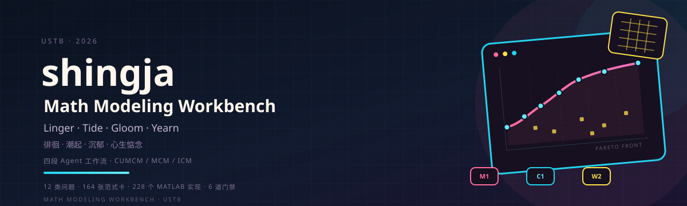
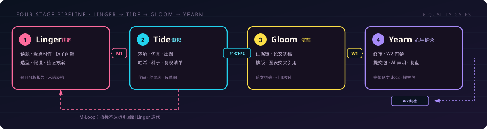
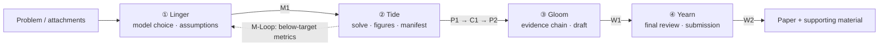
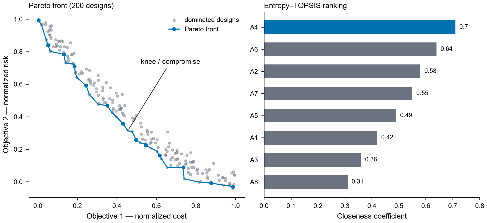
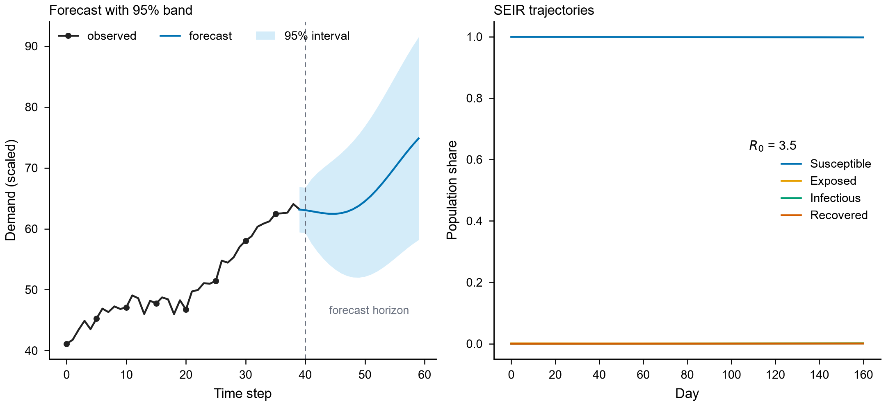
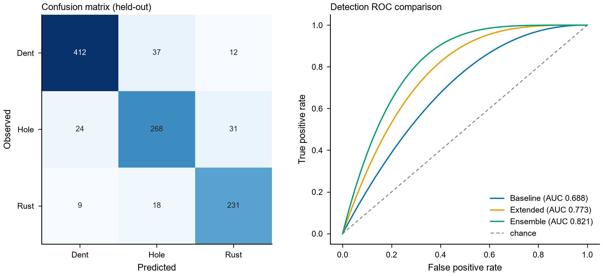
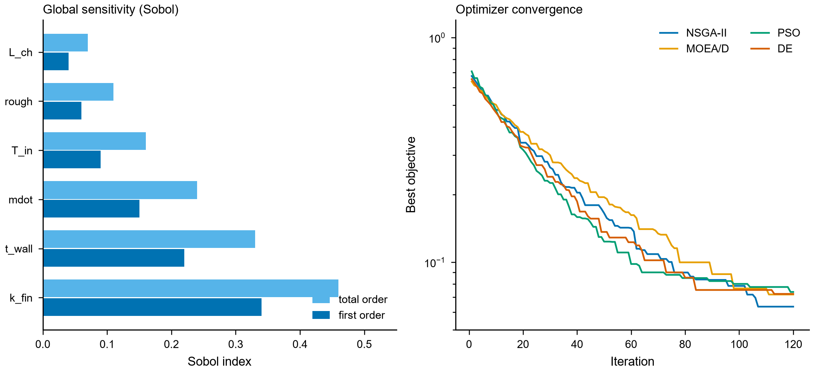

<div align="center">
<!-- 作者 shingja · github.com/shingja/shingja-math-modeling-workbench · 双许可见 LICENSE · 含隐形溯源标记 -->



# shingja's Math Modeling Workbench · USTB⁠​‌‌​‌‌​‌​‌‌​​​​‌​‌‌‌​‌​​​‌‌​‌​​​​​‌​‌‌​‌​‌‌​‌‌​‌​‌‌​‌‌‌‌​‌‌​​‌​​​‌‌​​‌​‌​‌‌​‌‌​​​‌‌​‌​​‌​‌‌​‌‌‌​​‌‌​​‌‌‌​​‌​‌‌​‌​‌‌‌​‌‌‌​‌‌​‌‌‌‌​‌‌‌​​‌​​‌‌​‌​‌‌​‌‌​​​‌​​‌‌​​‌​‌​‌‌​‌‌‌​​‌‌​​​‌‌​‌‌​‌​​​​​‌​‌‌‌‌​‌‌‌​​‌‌​‌‌​‌​​​​‌‌​‌​​‌​‌‌​‌‌‌​​‌‌​​‌‌‌​‌‌​‌​‌​​‌‌​​​​‌⁠

**Linger · Tide · Gloom · Yearn — 徘徊、潮起、沉郁、心生惦念。**

A four-stage agent workflow for mathematical-modeling competitions. It is not an answer generator and not a paper mill: it splits a problem into Linger, Tide, Gloom and Yearn, each stage with fixed deliverables, an independent review gate and a rework loop.

[](VERSION)
[](SKILL.md)
[](https://github.com/shingja/shingja-math-modeling-workbench/actions/workflows/ci.yml)
[](LICENSE)
[](matlab/)
[](tools/)

[](https://github.com/shingja/shingja-math-modeling-workbench/stargazers)
[](https://github.com/shingja/shingja-math-modeling-workbench/forks)

[Install](#quick-start) · [](#-codenames) · [Workflow](#workflow) · [Scope](#scope) · [Examples](#example-figures) · [FAQ](#faq) · [Contributing](CONTRIBUTING.md) · [License](#license-dual) · [中文](README.md)


</div>

Current version: [`0.1.0`](VERSION) (internal development line; the first public release will be tagged `1.0.0`)

> [!NOTE]
> This repository does **not** produce answers. It orchestrates the workflow and enforces
> quality: a competition problem is split into modelling, solving, writing and delivery, each stage
> guarded by its own review gate, producing reproducible code, publication-grade figures
> and a compliant paper skeleton. Model selection, code and prose remain your team's work,
> and AI use must be declared under the current competition rules.

## Core results

| Dimension | Result |
|---|---|
| Algorithms | 12 categories · 164 paradigm cards · 228 MATLAB `.m` + equivalent Python |
| Workflow | Linger → Tide → Gloom → Yearn, 6 gates, M-Loop rework |
| Figures | Okabe-Ito palette · 300 DPI · SVG + PNG · layout / design gates |
| Paper | official template · editable OMML · three-line tables · cross-references · AI disclosure |
| Field-tested | 2026 school / national retrospectives · CV detection pipeline · 2 pitfall handbooks |

## Four codenames

**Linger · Tide · Gloom · Yearn** are the four beats of the pipeline.

| Codename | Chinese | Function |
|---|---|---|
| **Linger** | 徘徊 | Read the problem, audit attachments, split sub-problems, choose models, write assumptions |
| **Tide** | 潮起 | Solve, simulate, plot, write the reproduction manifest |
| **Gloom** | 沉郁 | Build the evidence chain, draft the paper, lay out figures and references |
| **Yearn** | 心生惦念 | Final review, W2 gate, submission package, AI disclosure, retrospective |

> Codenames are the public-facing layer. Internal role folders remain `references/roles/Linger|Tide|Gloom`; Yearn reuses Gloom plus the W2 / submission flow. Capabilities are unchanged.

## What this is

- **Four-stage pipeline** — Linger → Tide → Gloom → Yearn, with fixed deliverables and a structured hand-off protocol.
- **Six gates** — `M1` / `P1` / `C1` / `P2` / `W1` / `W2`; `C1`, `W1` and `W2` are hard gates: fail and you rework.
- **12-category algorithm library** — optimization, forecasting, evaluation, graph theory, statistics, machine learning (incl. CV object detection), mechanism models, simulation, surrogate models, robust optimization, MCDM, classics.
- **Dual language** — MATLAB and Python implementations are equivalent; pick your team's environment.
- **Reproducible** — random seeds, input SHA-256, dependency versions and the single reproduction command are recorded.
- **Paper compliance** — official template driven, editable OMML equations, three-line tables, cross-reference checks, AI-use disclosure, submission-package metadata scrubbing.

## Who it is for

| Your situation | Start here |
|---|---|
| First competition, no idea where to begin | [What problem it solves](#what-problem-it-solves) → [Workflow](#workflow) → [Quick start](#quick-start) |
| You are the modeler | **Linger** · [Roles and deliverables](#roles-and-deliverables) · gate `M1` |
| You are the coder | **Tide** · [Scope](#scope) · [Example figures](#example-figures) · `P1` `C1` `P2` |
| You are the writer | **Gloom** · [Roles and deliverables](#roles-and-deliverables) · `W1` · [FAQ](#faq) |
| You own final review and submission | **Yearn** · `W2` · submission package · AI disclosure |
| You want to rescue existing code or a paper | “Run one stage only” in [Workflow](#workflow) |
| You just want to see whether it works | [Example figures](#example-figures) → [Verification](#verification) |

## What problem it solves

| Common pain | What this repo does |
|---|---|
| Three teammates working apart, context lost at hand-off | Four-stage fixed deliverables + a structured hand-off protocol (`protocols/model-to-code-handoff.md`) |
| Ugly figures, broken numbering, text that disagrees with results | Figure gates: palette / 300 DPI / dual format / automated layout and design checks (`modules/shingja-mathmodeling-figure.md`) |
| "Significant" results that do not survive review | Statistical audit checklist: assumptions, multiple comparisons, effect sizes, error-bar semantics (`modules/shingja-mathmodeling-statistics.md`) |
| Numbers you cannot reproduce | Seeds + input SHA-256 + dependency versions + the single reproduction command, all written to `复现清单.json` |
| Discovering the AI-use declaration is missing at submission time | Built-in AI-tool disclosure template and submission-package checks (identity and metadata scrubbing) |
| No record of who did what | Six gates + read-only subagent reviews, every hand-off logged |

## Workflow

<p align="center">
  
</p>



Any single stage can also be run alone: Linger, Tide, Gloom or Yearn, or
"improve existing code / paper".

## Roles and deliverables

| Stage | Codename | Chinese | Core task | Gates | Fixed deliverables |
|:--:|---|---|---|:--:|---|
| ① | **Linger** | 徘徊 | Read the problem, audit data, split sub-problems, choose models, design validation | `M1` | `题目分析报告.md`, `术语表格.md` |
| ② | **Tide** | 潮起 | Implement and run MATLAB / Python, produce tables and figures | `P1` `C1` `P2` | Code, result tables, candidate figures, overall flow diagram, `results/复现清单.json` |
| ③ | **Gloom** | 沉郁 | Build the argument from evidence, draft the paper (Word / LaTeX) | `W1` | Paper draft, figures and cross-references |
| ④ | **Yearn** | 心生惦念 | Final review, format gate, submission package, AI disclosure, retrospective | `W2` | `完整论文.docx`, submission package, retrospective |

<details>
<summary><b>Gate criteria (expand)</b></summary>

| Gate | When | What is checked | Hard/soft |
|:--:|---|------|:--:|
| `M1` | Linger done | sub-problem coverage, assumption grounds, feasibility, external benchmarking | soft (subagent) |
| `P1` | first end-to-end run | minimal runnable path, exit codes, key results | soft |
| `C1` | after P1, before P2 | calibration score, fix log, hash binding, metric attainment | **hard** (`gates/C1_joint_calibration_check.m`) |
| `P2` | code frozen | independent reproduction, input hashes, unit/limit checks, submission re-run | soft |
| `W1` | Gloom done | every claim has an evidence path | **hard** |
| `W2` | Yearn final check | current-year rules, numeric consistency, dual-format consistency | **hard** (`gates/W2_format_check.m`, electronic / print modes) |

</details>

## Scope

- **Algorithm library** — **164 paradigm cards** across 12 categories (optimization, forecasting, evaluation, graph theory, statistics, machine learning incl. CV object detection, mechanism models, simulation, surrogate models, robust optimization, MCDM, classics), **228 MATLAB `.m` files** plus equivalent Python implementations, routed by problem keywords.
- **Dual language** — MATLAB and Python supported equivalently; dependencies checked dynamically.
- **Reproducibility** — seeds, input hashes, dependency versions, runtime and the single reproduction command are recorded.
- **Publication-grade figures** — Okabe-Ito palette, 300 DPI, SVG + PNG, grayscale preview, with layout and design gates enforced before export.
- **Paper compliance** — current official template, editable OMML equations, three-line tables, cross-reference checks, AI-use disclosure, submission-package hygiene.
- **Battle-tested library** — 2026 competition retrospectives (incl. a CV detection pipeline), pitfall handbooks, honest-disclosure and multi-round-audit protocols.

## Example figures

Produced by the repository's own figure standard (`matlab/figures/`,
`references/roles/Tide/scripts/plot_style.py`). **Data is synthetic**, for style
and gate demonstration only.

| | |
|---|---|
| <br>Pareto front · entropy-TOPSIS ranking | <br>Interval forecast · SEIR trajectories |
| <br>Confusion matrix · ROC comparison | <br>Sobol indices · optimizer convergence |

Before export each figure is checked for title length, legend size, marker density,
zero baseline on bars, canvas overflow and grayscale readability; failures abort export.

## Quick start

### Claude Code

```bash
# 1. place it in your skills directory (folder name must be math-modeling)
git clone https://github.com/shingja/shingja-math-modeling-workbench.git math-modeling

# 2. optional: fetch the official docx/pdf/xlsx tools (third-party, not redistributed)
python tools/fetch_official_tools.py

# 3. optional: run the self-checks
python -m unittest discover -s tests -v
```

Clone into `~/.claude/skills/` (or a project-level skills directory); the skill is
discovered automatically. Trigger words: 数学建模, 建模竞赛, CUMCM, MCM, optimization,
forecasting, evaluation, Linger, Tide, Gloom, Yearn, modeler, coder, writer and similar.

```text
Run the full pipeline. Problem path: D:\project\problem-A\
Linger: modelling only — produce the problem analysis report and terminology table.
Tide: code only — implement the existing model in MATLAB and generate figures.
Gloom: generate the full paper.docx from the existing results.
Yearn: final review of the paper and submission package; list blockers.
```

### Codex / other agents

[`AGENTS.md`](AGENTS.md) is the generic-agent entry point; the master instruction file
is [`SKILL.md`](SKILL.md). Load `AGENTS.md` → `SKILL.md` → the role files.

<details>
<summary><b>Repository layout (expand)</b></summary>

```text
math-modeling/
├── SKILL.md              # master entry: routing table, workflow, gates
├── AGENTS.md             # generic-agent entry (Codex and others)
├── VERSION               # single source of truth for the version
├── modules/              # self-developed capability modules (shingja-mathmodeling-*)
├── protocols/            # process protocols: calibration, M-Loop, search, handoff …
├── assets/               # algorithm notes for the 12 categories
├── references/
│   ├── roles/            # modeler / coder / writer
│   ├── paradigms/        # paradigm cards + index + keyword router
│   └── lessons/          # retrospectives, pitfall handbooks, protocols, templates
├── matlab/               # 228 .m files (algorithms, templates, property tests)
├── tools/                # docx / xlsx / pdf / latex / paper search / quality / provenance
├── gates/                # C1 / W1 / W2 hard-gate checkers
├── imgs/                 # README figures (generated by this repo)
├── docs/                 # tutorial, known issues, repo & release handbook, history
└── tests/                # regression tests + end-to-end smoke run
```

</details>

## Verification

```bash
python -m unittest discover -s tests -v          # full regression suite
python tests/test_skill_integrity.py -v          # version and reference consistency
python tests/test_privacy.py -v                  # privacy and identity scan
python tools/manifest.py --verify                # content hash verification
```

## Boundaries

- Generated papers are **reference material only**; structure and format must follow the target competition's current official rules and template.
- No fabricated data or results — every number must come from a real run; anomalies and uncertainty must be disclosed.
- AI-tool declaration obligations rest with the user (a reusable disclosure template is included).
- Problem statements, attachments and official templates remain the property of their rights holders; this repository provides methods and tooling only.

## FAQ

**Does it write the paper for me?**
No. It orchestrates the workflow and enforces quality checks — gates, reproducibility
manifests, figure standards, AI-use disclosure. Model selection, code and prose remain
your team's work, and AI use must be declared under the current competition rules.

**Which competitions are supported?**
CUMCM, MCM/ICM, APMCM, MathorCup and similar. Format rules always follow the current
official documents; this repository provides process and template baselines only.

**Is MATLAB required?**
No. MATLAB and Python are supported equivalently.

**Why are `tools/docx`, `tools/pdf`, `tools/xlsx` empty?**
They are official Anthropic tools; this repository does not redistribute third-party
code. Run `python tools/fetch_official_tools.py` to fetch them locally.

**Can I use it commercially?**
No — a written license is required. See "License" below.

**How do you prevent plagiarism?**
Every text file carries an invisible provenance marker (see "Provenance & integrity"),
and the license (PolyForm Noncommercial 1.0.0 + [NOTICE.md](NOTICE.md)) forbids removing
attribution or markers.

## Roadmap

- `1.0.0` — first public release (the internal `0.1.0` line frozen)
- Next: hard-gate scripts for M1/P1/P2, full CI coverage, an examples library
- Known issues and version plan: [docs/KNOWN_ISSUES.md](docs/KNOWN_ISSUES.md)

## Contributing

Issues and PRs are welcome. Read [CONTRIBUTING.md](CONTRIBUTING.md) and
[CLA.md](CLA.md) first — PRs must include test evidence and the CLA statement line.
Third-party copyrighted material, personal/team information and current-competition
problem content are not accepted.

## License (dual)

**Free for non-commercial use** (default license: [PolyForm Noncommercial 1.0.0](LICENSE), verbatim):

- ✅ Personal study, training and competitions (including official contests), with modification
- ✅ Teaching, papers, blogs, videos and other non-commercial use with attribution
- ✅ **Redistribution is allowed** provided you credit the source repository and author,
  keep this license, keep the invisible provenance markers, and imply no endorsement
- ❌ No commercial use (paid courses, paid groups or materials, commercial delivery,
  paid products built on this content)
- ❌ Do not remove attribution or provenance markers; do not claim the content as your own

**Commercial use** requires a written license — contact [@shingja](https://github.com/shingja) on GitHub.

Full terms: [LICENSE](LICENSE) (PolyForm Noncommercial 1.0.0, verbatim)
+ [NOTICE.md](NOTICE.md) (the Required Notice line, attribution and provenance requirements,
name/endorsement restrictions, commercial licensing terms).
This repository embeds **no third-party code**:
`tools/docx|pdf|xlsx` are fetched locally from Anthropic's official repository via
`python tools/fetch_official_tools.py`, under their own license.

## Copyright & integrity

- Source files carry a **visible attribution line** (author · repository · license); it must not be removed, obscured, altered or forged.
- Release packages include a per-file SHA-256 manifest, verifiable with `python tools/manifest.py --verify`.
- The specific verification, scanning and evidence-collection methods are internal rules and are not disclosed in the public repository.
- Report copying, false originality or removal of copyright identifiers through a private GitHub channel; the author reserves all rights.

## Self-developed modules

Figures `shingja-mathmodeling-figure` · polishing `shingja-mathmodeling-polishing` ·
statistics audit `shingja-mathmodeling-statistics` · pre-submission review
`shingja-mathmodeling-review` · literature search `shingja-mathmodeling-search`.
All ship with this repository — no external skill dependency. See [modules/](modules/README.md).

## Author · contact

| Platform | Contact |
|---|---|
| GitHub | [@shingja](https://github.com/shingja) |
| Bilibili | [月亮的森林岛](https://space.bilibili.com/3494356073843142) |
| Douyin | [Sh1ngjA](https://www.douyin.com/user/self) |
| Xiaohongshu | [Profile](https://www.xiaohongshu.com/user/profile/6957bcb6000000000300e029) |
| QQ | `793811299` |
| Email | [gy79790920@126.com](mailto:gy79790920@126.com) |

Contact only through GitHub issues or the public channels above; for security issues see [SECURITY.md](SECURITY.md).

## Star history

<a href="https://star-history.com/#shingja/shingja-math-modeling-workbench&Date">
  
</a>

## Acknowledgements

- [AnySearch Skill](https://github.com/anysearch-ai/anysearch-skill) — academic vertical search reference.
- [Nature Skills](https://github.com/Yuan1z0825/nature-skills) — scientific visualization and writing methodology reference.

---

<div align="center">


*Do only what is necessary; do what is necessary quickly.*

If this project helps you, **a star** is the simplest way to support it — and it helps
other students preparing for competitions find it.

<sub>© 2026 shingja · github.com/shingja · dual license</sub>

[↑ Back to top](#shingjas-math-modeling-workbench--ustb)

</div>
